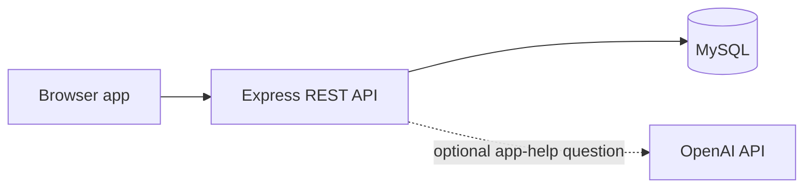

<div align="center">

# Student Management

Manage student records in a clean, responsive app backed by an Express API and MySQL.

<a href="https://student-management-system-production-2743b4fe.up.railway.app">
  
</a>
<a href="https://github.com/p34-wev/student-management-system">
  
</a>

<br>


<br>

<a href="https://student-management-system-production-2743b4fe.up.railway.app/api/health">API health</a>
&nbsp;·&nbsp;
<a href="#quick-start">Run locally</a>
&nbsp;·&nbsp;
<a href="#api-reference">Explore the API</a>

</div>

> [!NOTE]
> The live demo is hosted on Railway and may be unavailable if its trial or credits expire. Create an account to try the app; the cloud database starts separately from your local database.

## Quick navigation

- [Highlights](#highlights)
- [How it fits together](#how-it-fits-together)
- [Quick start](#quick-start)
- [Railway deployment](#railway-deployment)
- [API reference](#api-reference)
- [Privacy and demo limitations](#privacy-and-demo-limitations)

## Highlights

| Feature | What you can do |
| --- | --- |
| Student directory | Add, view, edit, delete, search, and filter student records |
| Overview | See student totals, course enrollment charts, and academic performance |
| Private accounts | Sign up with your own password; each account manages only its own records |
| AI app-help | Ask usage questions or search your loaded directory with `/student name` |
| Aadhaar demo | Try the demonstration status flow without entering an Aadhaar number or OTP |

## How it fits together



The browser and API are served from one origin. The AI assistant receives the app-help question only; student records are not sent to OpenAI. Name searches run locally in the browser.

## Quick start

<details open>
<summary><strong>Set up the app on your computer</strong></summary>

### Requirements

- Node.js 18 or newer
- MySQL 8 or newer

### Install and run

1. Clone the repository and enter its folder:

   ```sh
   git clone https://github.com/p34-wev/student-management-system.git
   cd student-management-system
   ```

2. Create the database tables:

   ```sh
   mysql -u root -p < schema.sql
   ```

3. Install packages and create your local environment file:

   ```sh
   npm ci
   ```

   In Windows PowerShell, copy the example file with:

   ```powershell
   Copy-Item .env.example .env
   ```

4. Edit `.env` with your MySQL connection details. Set:
   - `ADMIN_PASSWORD` to a unique password of at least 12 characters
   - `SESSION_SECRET` to a random secret of at least 32 characters
   - `ADMIN_EMAIL` if you want to use an administrator email other than `admin@localhost.test`
   - `OPENAI_API_KEY` only if you want to enable AI app-help

   Generate a session secret with:

   ```sh
   node -e "console.log(require('crypto').randomBytes(48).toString('base64url'))"
   ```

5. Start the server:

   ```sh
   npm start
   ```

6. Open [http://localhost:3000](http://localhost:3000), then choose **Create an account**.

> [!IMPORTANT]
> Use the Express address above for login and CRUD. Opening `index.html` directly or using Live Server on port 5500 serves static files without the backend API.

Check the API and MySQL connection at [http://localhost:3000/api/health](http://localhost:3000/api/health). A healthy response is `{"status":"ok","database":"connected"}`.

<details>
<summary><strong>Updating an existing database</strong></summary>

Back up the database first. Apply only migrations that your database still needs, in this order:

1. [`migration-add-aadhaar-demo-status.sql`](./migration-add-aadhaar-demo-status.sql)
2. [`migration-add-marks.sql`](./migration-add-marks.sql)
3. [`migration-add-user-accounts.sql`](./migration-add-user-accounts.sql)

For example:

```sh
mysql -u root -p < migration-add-aadhaar-demo-status.sql
mysql -u root -p < migration-add-marks.sql
mysql -u root -p < migration-add-user-accounts.sql
```

On first startup after the account migration, unowned existing records are assigned to the configured legacy administrator account. The bootstrap `ADMIN_PASSWORD` is used only when creating that account; changing the environment variable later does not reset its password.

</details>
</details>

## Railway deployment

This repository is connected to Railway and deploys from the `main` branch.

<p>
  <a href="https://student-management-system-production-2743b4fe.up.railway.app">
    
  </a>
  <a href="https://student-management-system-production-2743b4fe.up.railway.app/api/health">
    
  </a>
</p>

<details>
<summary><strong>Deploy your own copy on Railway</strong></summary>

1. Create a Railway project from this GitHub repository and add a MySQL service.
2. In the app service, reference the MySQL service variables. Replace `MySQL` if your database service has a different name:

   ```text
   DB_HOST=${{MySQL.MYSQLHOST}}
   DB_PORT=${{MySQL.MYSQLPORT}}
   DB_USER=${{MySQL.MYSQLUSER}}
   DB_PASSWORD=${{MySQL.MYSQLPASSWORD}}
   DB_NAME=student_management
   NODE_ENV=production
   ```

3. Add private Railway variables for `ADMIN_EMAIL`, `ADMIN_PASSWORD` (at least 12 characters), and `SESSION_SECRET` (at least 32 random characters). Never put secrets in GitHub or in this README.
4. Initialize the Railway MySQL database with [`schema.sql`](./schema.sql). For an existing database, apply the needed migration files instead of re-running the fresh-install schema.
5. Generate a public domain in the app service's **Settings → Networking**.
6. Visit `https://<your-domain>/api/health`. The service is ready when it returns `{"status":"ok","database":"connected"}`.

Railway supplies `PORT` automatically. The application also accepts `MYSQLHOST`, `MYSQLPORT`, `MYSQLUSER`, `MYSQLPASSWORD`, and `MYSQLDATABASE` directly when configured for the database.

</details>

## API reference

<details>
<summary><strong>View routes and access rules</strong></summary>

| Method | Route | Access | Description |
| --- | --- | --- | --- |
| `GET` | `/api/health` | Public | Check API and MySQL connectivity |
| `GET` | `/api/auth/status` | Public | Check the current account session |
| `POST` | `/api/auth/register` | Public | Create an account and private directory |
| `POST` | `/api/auth/login` | Public | Sign in with email and password |
| `POST` | `/api/auth/logout` | Public | Clear the session cookie |
| `GET` | `/api/students` | Session | List your students |
| `GET` | `/api/students/:id` | Session | Get one of your students |
| `POST` | `/api/students` | Session | Create a student |
| `PUT` | `/api/students/:id` | Session | Update a student |
| `DELETE` | `/api/students/:id` | Session | Delete a student |
| `POST` | `/api/students/:id/aadhaar-demo-verification` | Session | Complete the demo status flow |
| `GET` | `/api/assistant/status` | Session | Check whether AI help is configured |
| `POST` | `/api/assistant/chat` | Session | Ask an app-help question |

Student fields: `full_name`, `email`, optional `phone`, `course`, `enrollment_date` (`YYYY-MM-DD`), and `status` (`Active` or `Inactive`). A student email must be unique within its account.

</details>

## Privacy and demo limitations

- Student routes are scoped to the signed-in account.
- Passwords are stored as scrypt hashes; keep `SESSION_SECRET` and database credentials private.
- The Aadhaar feature records demo status only. It does **not** verify identity and does not collect or store Aadhaar numbers or OTPs.
- Real Aadhaar verification requires an authorized provider.
- To enable AI app-help, configure `OPENAI_API_KEY` as a server-side environment variable. Student records are not included in assistant requests.

## Run tests

```sh
npm test
```
